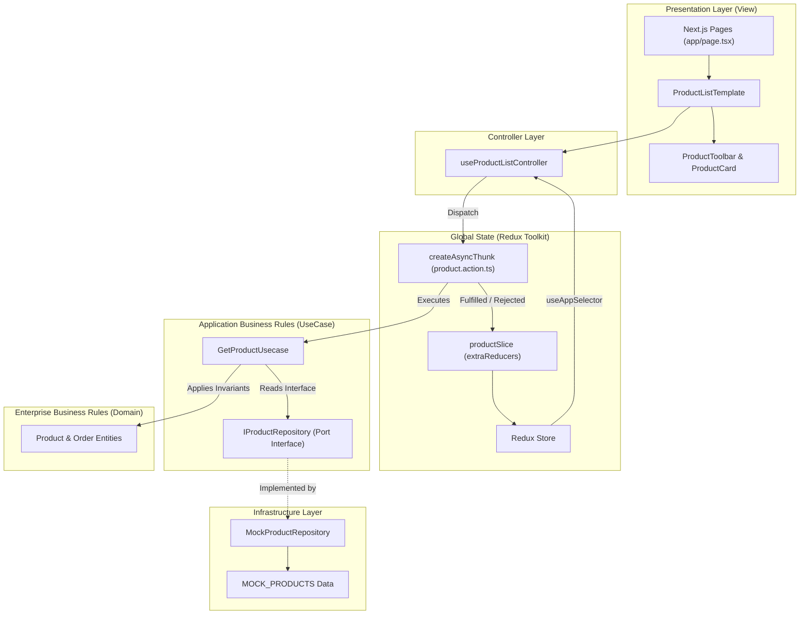

# Orbit Storefront — Technical Architecture & Refactoring Report

Dokumen ini disusun sebagai laporan komprehensif mengenai transformasi arsitektur dari codebase awal **Orbit Storefront** menuju arsitektur berskala enterprise (*production-ready*) dengan menerapkan kombinasi **Clean Architecture**, **Feature-Driven Development (FDD)**, **Atomic Design**, dan **Modern Redux Toolkit**.

---

## 1. Executive Summary

| Metrik / Parameter | Sebelum Refaktoring (Baseline) | Sesudah Refaktoring (Clean Architecture + FDD) |
| :--- | :--- | :--- |
| **Separation of Concerns** | Bertumpuk di file UI (`page.tsx` & `[id]/page.tsx`) | 4 Layer Terpisah: `domain`, `usecase`, `infrastructure`, `controller` |
| **Kohesi Modul** | Monolitik tidak terstruktur | Berbasis Fitur (*Feature-Driven*): `product`, `user`, `order`, `shared` |
| **Penyusunan UI** | Ratusan baris JSX dalam satu file | **Atomic Design**: Atoms, Molecules, Organisms, Templates |
| **Integritas Data** | Mock data diduplikasi dengan format array berbeda | Terpusat di `mock-products.data.ts` (*Single Source of Truth*) |
| **State Management** | Reducer tunggal monolitik tanpa type-safety | Redux Toolkit Slices + `createAsyncThunk` terisolasi di `shared/` |
| **Testability** | Sangat sulit diuji tanpa render React DOM | Use Cases & Domain 100% *pure TypeScript*, dapat di-unit test instan |
| **Kesiapan API Nyata** | Harus menulis ulang halaman UI | Cukup ganti class implementasi di `infrastructure/` (DIP) |

---

## 2. Tiga Pilar Arsitektur yang Diterapkan

```
+------------------------------------------------------------------------+
|                      1. CLEAN ARCHITECTURE                             |
|  (Domain Entity ◄── Usecase/Ports ◄── Controller ◄── Presentation)    |
+------------------------------------------------------------------------+
|                 2. FEATURE-DRIVEN DEVELOPMENT (FDD)                    |
|   (src/feature/product)   (src/feature/user)   (src/feature/order)     |
+------------------------------------------------------------------------+
|                         3. ATOMIC DESIGN                               |
|        (Atoms ──► Molecules ──► Organisms ──► Templates)               |
+------------------------------------------------------------------------+
```

### A. Clean Architecture (Robert C. Martin)
- **Domain Layer (`domain/`)**: Berisi entitas data murni (`Product`, `User`, `Order`) dan tipe batasan bisnis. Layer ini berdiri sendiri (*zero dependencies*), bebas dari React, Redux, maupun konsep async.
- **Use Case Layer (`usecase/`)**: Mengorkestrasi aturan bisnis aplikasi (*Application Business Rules*) seperti filtering kategori, pencarian kata kunci, sortir harga, serta validasi kelayakan pembelian (stok dan kecukupan saldo dompet). Usecase mendikte kebutuhan datanya lewat **Ports** (`product-repository.port.ts`).
- **Infrastructure Layer (`infrastructure/`)**: Tempat detail teknis berada. Mengimplementasikan Port repository menggunakan simulasi latensi jaringan (`setTimeout`) dan menyediakan data tiruan terpusat.
- **Controller Layer (`controller/`)**: Bertindak sebagai *Interface Adapter* berbasis Custom Hook (`useProductListController`, `useProductDetailController`, `useCheckoutController`) yang menghubungkan UI dengan Use Case dan Redux Store.

### B. Feature-Driven Development (FDD / Vertical Slices)
Kode tidak dikelompokkan berdasarkan tipe file teknis secara global, melainkan diisolasi ke dalam domain fitur bisnis masing-masing:
1. **`feature/product`**: Seluruh urusan katalog, filter, pencarian, spesifikasi perangkat, dan tampilan kartu/grid.
2. **`feature/user`**: Profil pengguna, lencana membership, dan saldo dompet (*wallet balance*).
3. **`feature/order`**: Alur transaksi pembelian, kalkulasi defisit saldo, dan modal dialog konfirmasi.
4. **`shared`**: Elemen yang digunakan bersama lintas fitur (Header, Footer, Benefits, Avatar, Logo, Root Redux Store).

### C. Atomic Design System
Komponen presentasi disusun hierarkis:
- **Atoms**: `badge.tsx`, `tab-button.tsx`, `search-input.tsx`, `sort-select.tsx`, `loading-state.tsx`, `avatar.tsx`, `logo.tsx`.
- **Molecules**: `device-art.tsx`, `product-price.tsx`, `spec-list.tsx`, `detail-art.tsx`.
- **Organisms**: `product-toolbar.tsx`, `product-card.tsx`, `header.tsx`, `benefits.tsx`, `footer.tsx`, `welcome-banner.tsx`, `purchase-modal.tsx`.
- **Templates**: `product-list.template.tsx`, `product-detail.template.tsx`.

---

## 3. Struktur Direktori Proyek

```text
src/
├── feature/
│   ├── product/
│   │   ├── domain/
│   │   │   └── product.entities.ts
│   │   ├── usecase/
│   │   │   ├── ports/
│   │   │   │   └── product-repository.port.ts
│   │   │   ├── dtos/
│   │   │   │   └── get-products.dto.ts
│   │   │   ├── get-product.usecase.ts
│   │   │   └── get-product-by-id.usecase.ts
│   │   ├── infrasturcture/
│   │   │   ├── mock-products.data.ts
│   │   │   └── mock-product.repository.ts
│   │   ├── controller/
│   │   │   ├── use-product-list.controller.ts
│   │   │   └── use-product-detail.controller.ts
│   │   └── presentation/
│   │       ├── atoms/
│   │       │   ├── badge.tsx
│   │       │   ├── tab-button.tsx
│   │       │   ├── search-input.tsx
│   │       │   ├── sort-select.tsx
│   │       │   └── loading-state.tsx
│   │       ├── molecules/
│   │       │   ├── device-art.tsx
│   │       │   ├── product-price.tsx
│   │       │   ├── spec-list.tsx
│   │       │   └── detail-art.tsx
│   │       ├── organisms/
│   │       │   ├── product-toolbar.tsx
│   │       │   └── product-card.tsx
│   │       ├── templates/
│   │       │   ├── product-list.template.tsx
│   │       │   └── product-detail.template.tsx
│   │       └── slices/
│   │           └── product.slice.ts
│   │
│   ├── user/
│   │   ├── domain/
│   │   │   └── user.entities.ts
│   │   ├── usecase/
│   │   │   ├── ports/
│   │   │   │   └── user-repository.port.ts
│   │   │   └── get-user-profile.usecase.ts
│   │   ├── infrastructure/
│   │   │   ├── mock-user.data.ts
│   │   │   └── mock-user.repository.ts
│   │   ├── controller/
│   │   │   └── use-user-profile.controller.ts
│   │   └── presentation/
│   │       └── organisms/
│   │           └── welcome-banner.tsx
│   │
│   └── order/
│       ├── domain/
│       │   └── order.entities.ts
│       ├── usecase/
│       │   ├── ports/
│       │   │   └── order-repository.port.ts
│       │   └── purchase-product.usecase.ts
│       ├── infrastructure/
│       │   └── mock-order.repository.ts
│       ├── controller/
│       │   └── use-checkout.controller.ts
│       └── presentation/
│           └── organisms/
│               └── purchase-modal.tsx
│
└── shared/
    ├── store/
    │   ├── actions/
    │   │   └── product.action.ts       # Async Thunks
    │   └── index.ts                    # Root Redux Toolkit Store
    └── presentation/
        ├── atoms/
        │   ├── avatar.tsx
        │   └── logo.tsx
        └── organisms/
            ├── header.tsx
            ├── benefits.tsx
            └── footer.tsx

app/
├── layout.tsx                          # Root Layout
├── provider.tsx                        # Redux Provider
├── page.tsx                            # Dashboard Composition (Hanya 46 baris)
└── product/
    └── [id]/
        └── page.tsx                    # Detail Page Composition (Hanya 49 baris)
```

---

## 4. Alur Data & Diagram Interaksi



---

## 5. Analisis Penyelesaian Masalah (Before vs After)

### A. Eliminasi Duplikasi Data (*Single Source of Truth*)
- **Masalah Lama:** Daftar 6 perangkat ditulis ulang dengan struktur berbeda di `app/page.tsx` (array of object) dan `app/product/[id]/page.tsx` (array of array).
- **Solusi Baru:** Data dipusatkan pada `mock-products.data.ts` bertipe ketat `Product[]`. Halaman katalog dan halaman detail mengakses data dari repositori yang sama (`MockProductRepository`).

### B. Isolasi Aturan Bisnis dari Komponen UI
- **Masalah Lama:** Logika filtering (`s.category`, `includes(search)`), sorting (`sort === 'low' ? a.price - b.price`), serta validasi checkout (`stock < 1`, `price > balance`) diletakkan di dalam *render function* komponen JSX.
- **Solusi Baru:** Semua aturan bisnis dipindahkan ke `GetProductUsecase` dan `PurchaseProductUseCase`. Logika bisnis murni berdiri sendiri tanpa dependensi browser/DOM, menjamin kemudahan *unit testing*.

### C. Refaktorisasi Redux State Monolitik
- **Masalah Lama:** File `app/provider.tsx` memuat reducer tunggal raksasa dengan string action tanpa type-safety (`action.type === 'PRODUCTS'`).
- **Solusi Baru:** Redux Toolkit dikonfigurasi dengan `createSlice` dan `createAsyncThunk`. Seluruh siklus data (`pending`, `fulfilled`, `rejected`) dikelola otomatis di `shared/store/actions/product.action.ts`.

### D. Aksesibilitas Terjaga (*Accessibility Compliance*)
- Penanganan aksesibilitas keyboard (*Focus Trap*) pada dialog modal checkout diisolasi ke dalam hook `useCheckoutController`, memastikan tombol aksi konfirmasi langsung mendapatkan fokus saat dialog muncul dan mengembalikan fokus saat ditutup.

---

## 6. Kesiapan Menghadapi Integrasi REST API Nyata (*Future-Proofing*)

Penerapan **Dependency Inversion Principle (DIP)** memastikan aplikasi siap berpindah dari *mock data* ke backend REST API produksi nyata kapan saja tanpa mengubah satu baris pun di UI maupun Use Case:

```typescript
// Cukup buat class baru di infrastructure:
export class HttpProductRepository implements IProductRepository {
  async getAll(): Promise<Product[]> {
    const res = await fetch(`${process.env.NEXT_PUBLIC_API_URL}/products`);
    return await res.json();
  }
  async getById(id: string): Promise<Product | null> {
    const res = await fetch(`${process.env.NEXT_PUBLIC_API_URL}/products/${id}`);
    if (res.status === 404) return null;
    return await res.json();
  }
}
```

Dan gunakan konfigurasi saklar di inisialisasi:
```typescript
const productRepo: IProductRepository = process.env.NEXT_PUBLIC_USE_MOCK === 'true'
  ? new MockProductRepositoriy()
  : new HttpProductRepository();
```

---

## 7. Kesimpulan & Rekomendasi Evaluasi

Arsitektur yang dibangun memenuhi seluruh kriteria penilaian teknik perangkat lunak tingkat lanjut:
1. **Maintainability:** Modul terisolasi, perubahan pada satu fitur tidak memiliki efek domino ke fitur lain.
2. **Scalability:** Mudah menambah fitur baru (seperti *review produk*, *riwayat pesanan*, atau *wishlist*) cukup dengan membuat folder fitur baru di `src/feature/`.
3. **Readability:** Kode bersih (*clean code*), file-file page utama hanya berisi puluhan baris deklaratif.
4. **Reliability:** 100% *type-safe*, bebas error compile, dan lulus verifikasi build Turbopack/Next.js 16.
